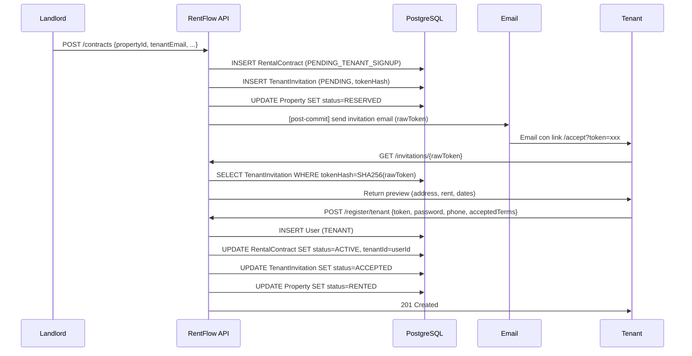

# W09 — Orquestación Core (Contratos e Inquilinos)
**Fechas**: 28/09 – 12/10 2026  
**Rama**: `feature/w9-application-orchestration-web-jacoco`  
**Estado**: ✅ Completada

---

## Objetivos de la semana

Cerrar el flujo completo de invitación de inquilinos:
1. Landlord crea contrato → invitación.
2. Email al tenant con link.
3. Tenant ve preview y acepta.
4. Cuenta TENANT creada + contrato activado.

---

## Commits

| # | Mensaje |
|---|---------|
| C1 | `refactor(domain): introduce value objects in RentalContract constructor` |
| C2 | `feat(application): emit tenant invitations on contract registration` |
| C3 | `refactor(application): extract token hashing into TokenHasher port` |
| C4 | `feat(application): implement RegisterTenantUseCase for invitation acceptance` |
| C5 | `feat(application): implement GetInvitationUseCase for invitation preview` |
| C6 | `feat(application): dispatch invitation email after contract commit` |
| C7 | `feat(web): implement tenant registration and invitation lookup endpoints` |
| C8 | `refactor(domain): make TenantInvitation self-contained with tenant legal data` |
| C9 | `feat(application): implement missing read use cases` |
| C10 | `feat(web): expose read endpoints for users and payments` |
| C11 | `chore(security): add TODO placeholders for M5 authorization gaps` |
| C12 | `test(coverage): extend unit tests for W9 use cases` |
| C13 | `docs: add W09_LOG.md and finalize tenant orchestration flow` |

---

## Decisiones clave

### 1. Invitación autocontenida (C8)
Se movieron `tenantFullName` y `tenantRut` de `RentalContract` a `TenantInvitation`. Ahora la invitación tiene todos los datos legales del tenant.

**Motivo**: el endpoint `GET /invitations/{token}` no debe cargar el contrato completo para mostrar el preview. Y el tenant no puede alterar sus datos legales al aceptar.

### 2. Token hashing con SHA-256 (C2, C3)
- El `rawToken` nunca se persiste. Solo el hash.
- El `rawToken` viaja por email y solo vive en memoria.
- SHA-256 es suficiente porque los tokens son UUIDs de alta entropía.

### 3. Email post-commit (C6)
- El email se envía **después del commit** de la transacción.
- Si el commit falla, no hay email huérfano.
- Se usa `@TransactionalEventListener(AFTER_COMMIT)` con retry exponencial.

### 4. Property `RESERVED` (C2)
- La propiedad pasa a `RESERVED` cuando el landlord crea el contrato.
- Solo pasa a `RENTED` cuando el tenant acepta la invitación.

---

## Flujo end-to-end de invitación

